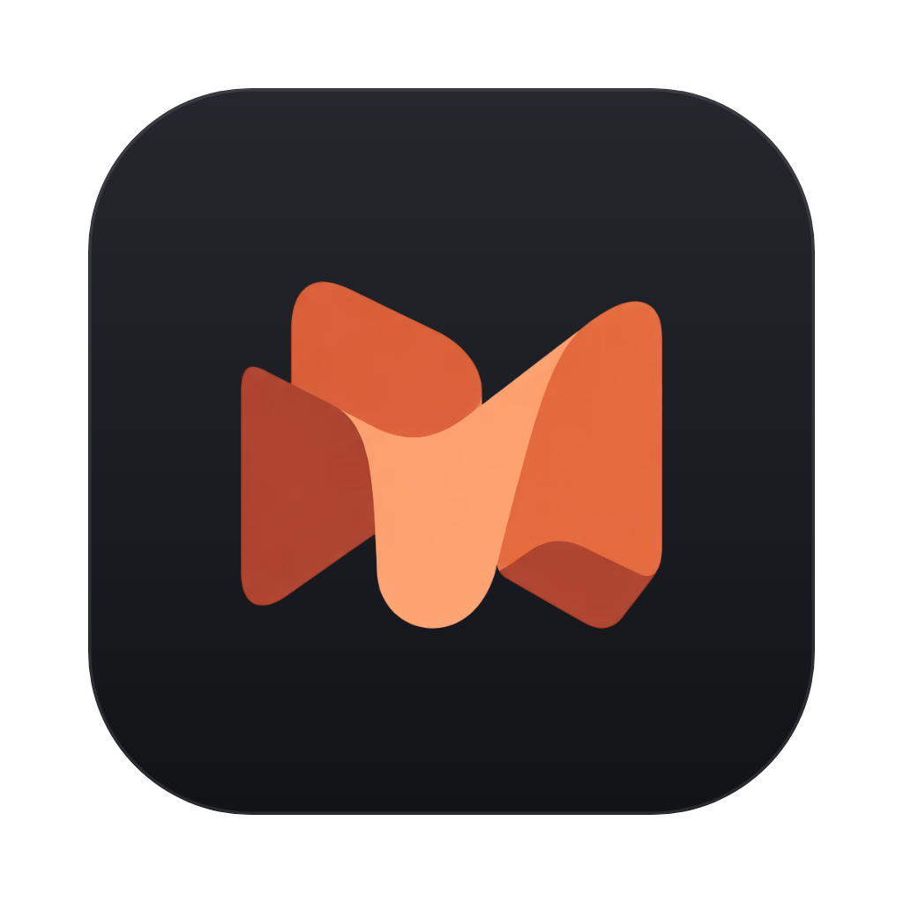
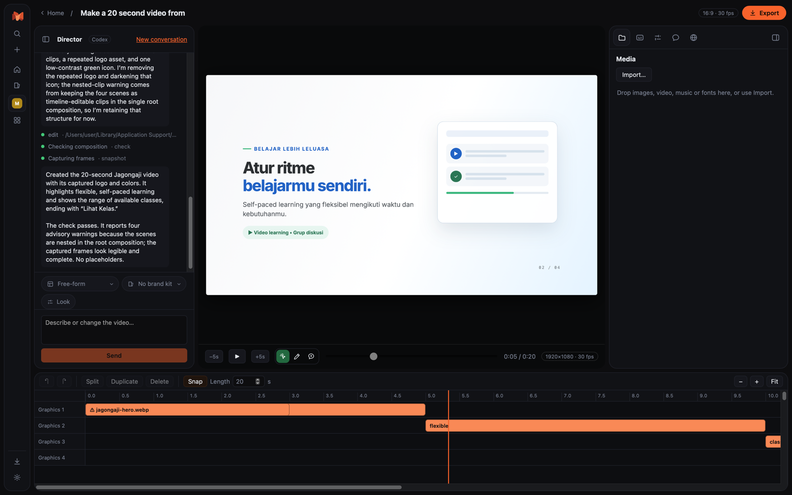
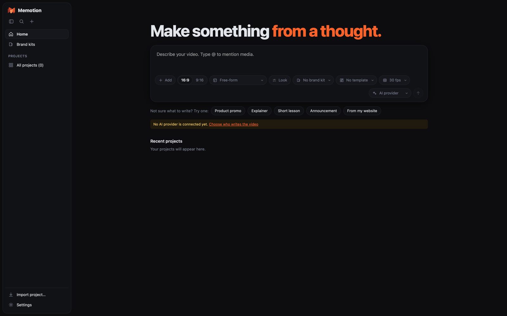
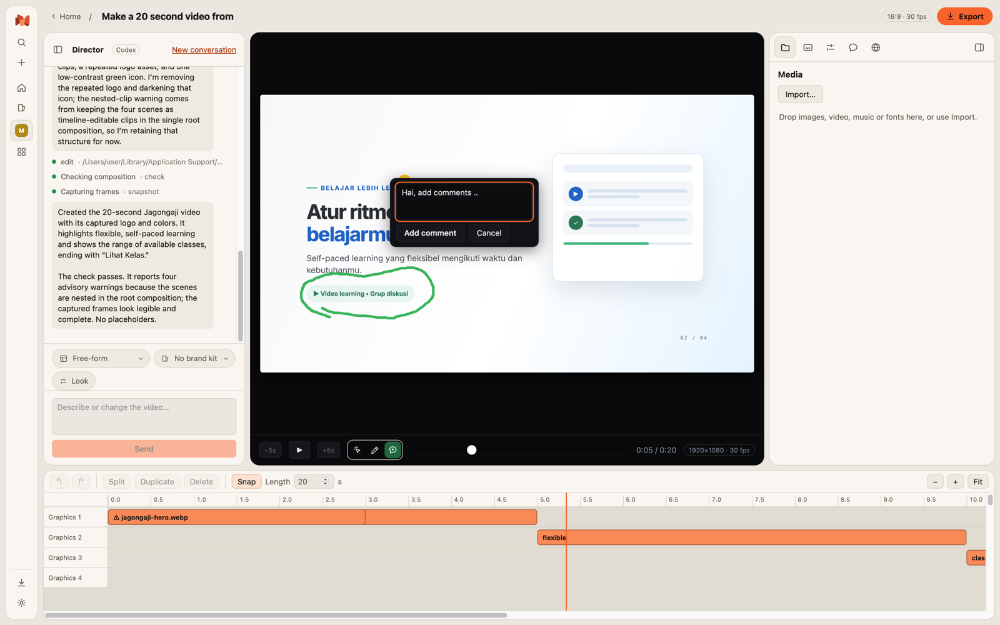
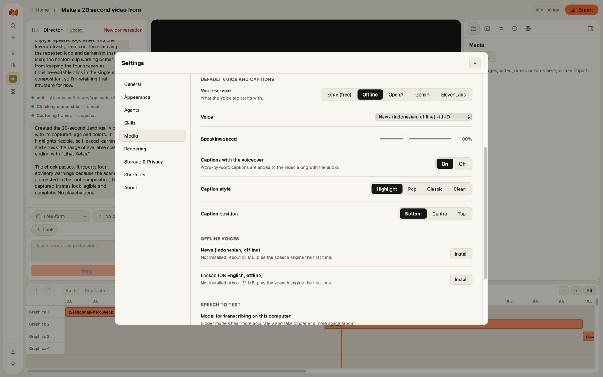
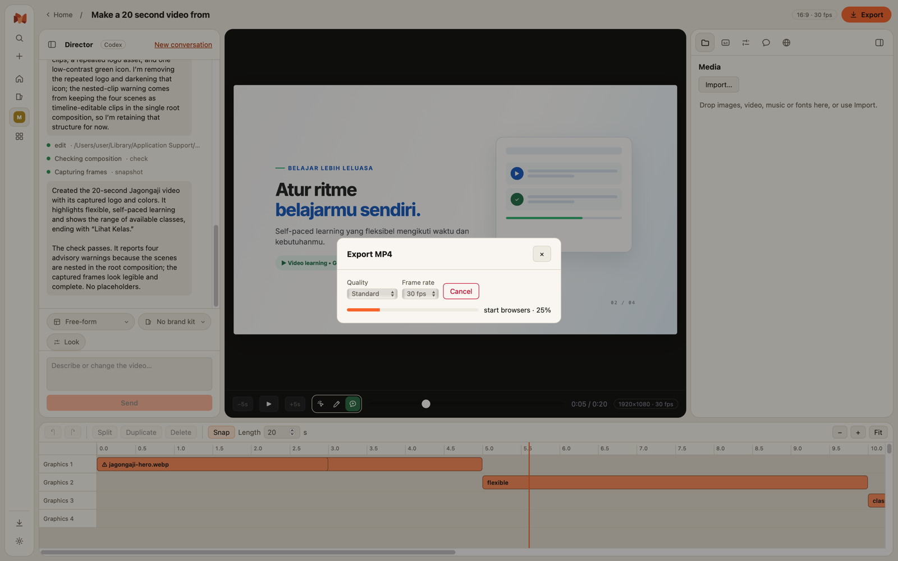

<div align="center">



# Memotion

[Bahasa Indonesia](README.md) · **English**

**Turn text descriptions into HTML/GSAP motion-graphics videos with an AI director, complete with voiceovers, word-by-word captions, and a visual timeline.**

[](LICENSE)
[](#download--installation)
[](https://github.com/abiiayyas/memotion/actions/workflows/ci.yml)
[](https://github.com/abiiayyas/memotion/actions/workflows/build.yml)

[Download](#download--installation) · [Features](#key-features) · [Architecture](docs/engineering/ARCHITECTURE.md) · [Development](#running-from-source) · [Changelog](CHANGELOG.md)

</div>

---

<div align="center">
  
</div>

## About Memotion

**Memotion** is a free, open-source prompt-to-video desktop application. Describe the video you want, an AI director writes an HTML/GSAP composition behind the scenes, and you preview it live and render **MP4 (16:9 or 9:16, 30 or 60 fps)** using the open-source [HyperFrames](https://github.com/heygen-com/hyperframes) rendering engine (`0.8.168`).

All projects and media stay local on your computer. API keys are stored securely in your operating system keychain (`@napi-rs/keyring`) and never written to disk in plain text. HyperFrames telemetry and automatic update checks are always turned off.

---

## Screenshots & Workflow

<table>
  <tr>
    <td width="50%" valign="top">
      
      <br />
      <strong>Home</strong> — Write a video prompt, attach media with <code>@</code>, pick 16:9 or 9:16, story structure, visual <em>Look</em>, <em>Brand kit</em>, <em>Template</em>, frame rate, and an AI provider or local CLI coding agent.
    </td>
    <td width="50%" valign="top">
      
      <br />
      <strong>Select, Draw &amp; Comment on Preview</strong> — Click elements directly on the video stage, circle areas to change, or pin timed comments so the AI director edits the exact target.
    </td>
  </tr>
  <tr>
    <td width="50%" valign="top">
      
      <br />
      <strong>Voice, Captions &amp; AI Agents</strong> — Generate voiceovers with Edge TTS, offline Piper voices (Indonesian &amp; English), OpenAI, Google Gemini TTS, or ElevenLabs; transcribe audio with <code>whisper.cpp</code>; and configure local CLI agents.
    </td>
    <td width="50%" valign="top">
      
      <br />
      <strong>Timeline &amp; Export MP4</strong> — Drag, trim, split, and group clips with atomic undo/redo on the multi-lane timeline, then render MP4 in 16:9 or 9:16 at 30 or 60 fps.
    </td>
  </tr>
</table>

---

## Key Features

- **AI Director & Local Coding Agents:** Connect any OpenAI-compatible API (presets for OpenAI, Anthropic, Gemini, DeepSeek, xAI Grok, OpenRouter, OpenCode Zen, Command Code, Custom) or drive **Claude Code**, **Codex**, and **OpenCode** in isolation through a per-run local MCP server.
- **Interactive Preview Tools & Vision Reviewer:** Pick live DOM elements (*Select*), sketch over frames (*Draw*), or drop timed pins (*Comment*). Vision-capable providers can automatically inspect scene frames via the `review` tool before finishing.
- **Multi-Lane Visual Timeline:** Move, edge-trim, split (`S`), duplicate (`D`), delete (`⌫`), marquee multi-select, drag across lanes, snap, and atomically undo/redo edits via `hyperframes timeline`.
- **Voiceovers & Word-by-Word Captions:** Built-in support for **Edge TTS**, offline **Piper** voices (`sherpa-onnx` Indonesian & English), **OpenAI TTS**, **Google Gemini TTS**, and **ElevenLabs**, plus Whisper cloud or local `whisper.cpp` transcription with 4 caption styles (`highlight`, `pop`, `classic`, `clean`).
- **Brand Kits, Look Catalog, Templates, Skills & Website Capture:** Save palettes, fonts, and logos in *Brand kits*; guide direction with *Look* catalog picks; instantiate variable *Templates*; install Markdown *Skills* from GitHub or local folders; and capture live websites for visual references.
- **Project Import & Offline Rendering:** Import HyperFrames or Remotion projects (analyzed and converted by AI, or rendered directly as footage), with local GSAP localization so previews and renders work offline.

---

## Download & Installation

Download the latest installer for **macOS** (`.dmg`) and **Windows** (`.exe`) from **[GitHub Releases](https://github.com/abiiayyas/memotion/releases/latest)**.

> [!NOTE]
> **Opening the app for the first time (unsigned builds):**
> - **macOS (Gatekeeper):** Right-click *Memotion* in Applications and choose **Open** → **Open** (or allow via *System Settings > Privacy & Security > Open Anyway*).
> - **Windows (SmartScreen):** In the *Windows protected your PC* dialog, click **More info** and then **Run anyway**.

**Runtime requirements for rendering:** install `ffmpeg` and `ffprobe` on your system `PATH` (for example `brew install ffmpeg` on macOS or `winget install Gyan.FFmpeg` on Windows), then download the rendering Chrome browser from **Settings > Rendering**.

---

## Running from Source

Requires **Node.js 22+**, **pnpm**, **Rust** (for the Tauri shell), and **ffmpeg** on `PATH` (macOS or Windows).

```bash
pnpm install
pnpm dev            # run the Tauri desktop app with hot reload
pnpm typecheck      # strict TypeScript checks (app and sidecar)
pnpm test           # Vitest unit and integration tests
pnpm build          # build release app for the current platform
pnpm build:mac      # build macOS .app bundle and .dmg installer
pnpm build:win      # build Windows NSIS (.exe) installer
```

To keep development data separate from your real projects:

```bash
MEMOTION_DATA_DIR=/tmp/memotion-dev pnpm dev
```

Contribution guidelines and technical architecture notes are available in [CONTRIBUTING.md](CONTRIBUTING.md) and [docs/engineering/ARCHITECTURE.md](docs/engineering/ARCHITECTURE.md).

---

## Structure & Tech Stack

```text
app/
  src/              React + TypeScript UI (Home, Editor, Timeline, Preview, Settings)
  src-tauri/        Tauri 2 Rust shell: spawns the Node sidecar and manages windows
  scripts/          build helper to bundle Node for release builds
sidecar/
  src/              local Hono server: AI agent loop, MCP CLI runner, TTS/STT, media, preview proxy
  test/             Vitest unit and integration suites
assets/             master logo and app icon assets
docs/               architecture documentation and screenshots
```

| Layer | Technology |
|---|---|
| Desktop Shell | Tauri 2 (Rust) |
| User Interface | React 19, TypeScript, Vite |
| Sidecar & Security | Node.js 22, Hono, `@napi-rs/keyring`, Zod |
| Video Engine | HyperFrames (`0.8.168`), GSAP, FFmpeg |
| Voice & Transcription | Edge TTS, `sherpa-onnx` (offline Piper), OpenAI, Gemini TTS, ElevenLabs, `whisper.cpp` |

---

## License & Attribution

- **Memotion source code:** [MIT License](LICENSE).
- **Video rendering engine:** [HyperFrames](https://github.com/heygen-com/hyperframes) (Apache-2.0).

| Third-Party Component | License |
|---|---|
| [HyperFrames](https://github.com/heygen-com/hyperframes) | Apache-2.0 |
| [sherpa-onnx](https://github.com/k2-fsa/sherpa-onnx) & Piper voice models | Apache-2.0 (and per-voice licenses) |
| [whisper.cpp](https://github.com/ggml-org/whisper.cpp) | MIT |
| [GSAP](https://gsap.com/standard-license) (downloaded on demand) | GreenSock Standard License |
| FFmpeg (system binary) | LGPL / GPL depending on installed build |

Full dependency details and third-party notices are listed in [THIRD_PARTY_NOTICES.md](THIRD_PARTY_NOTICES.md). To report security vulnerabilities, please follow [SECURITY.md](SECURITY.md).
