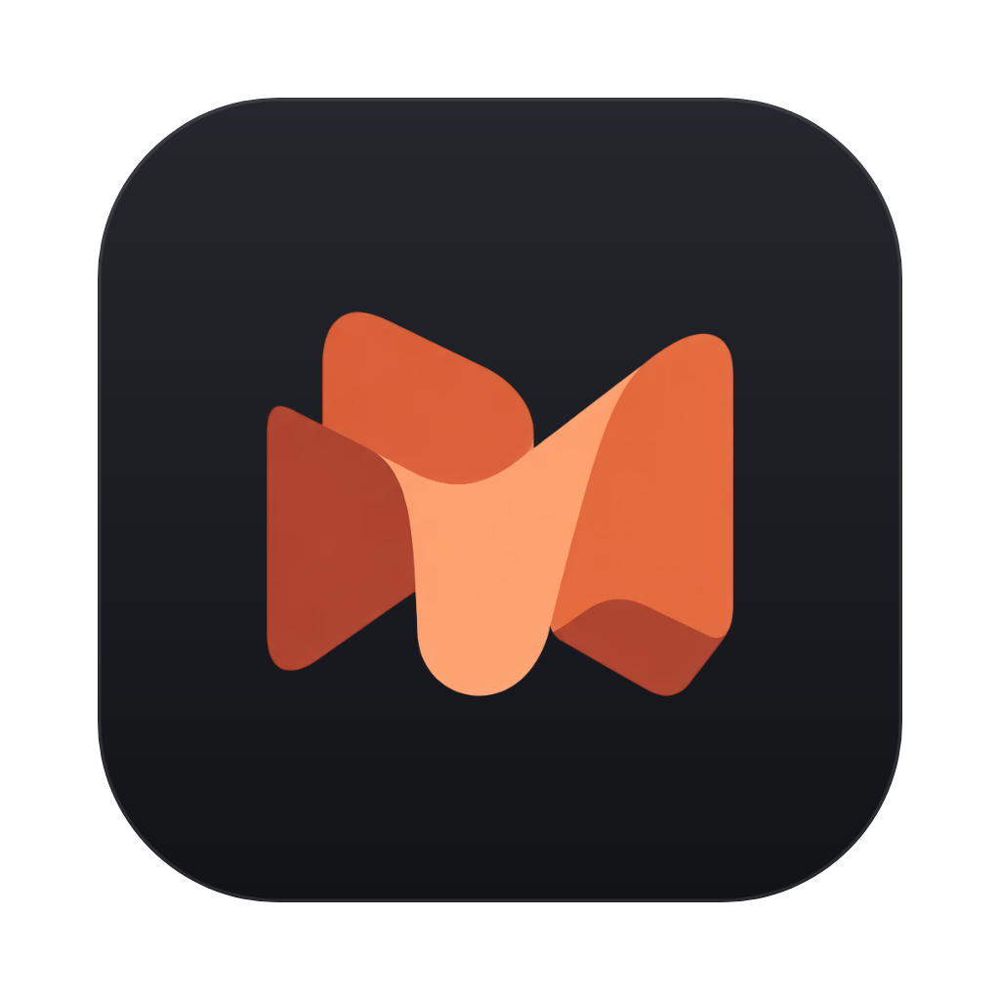
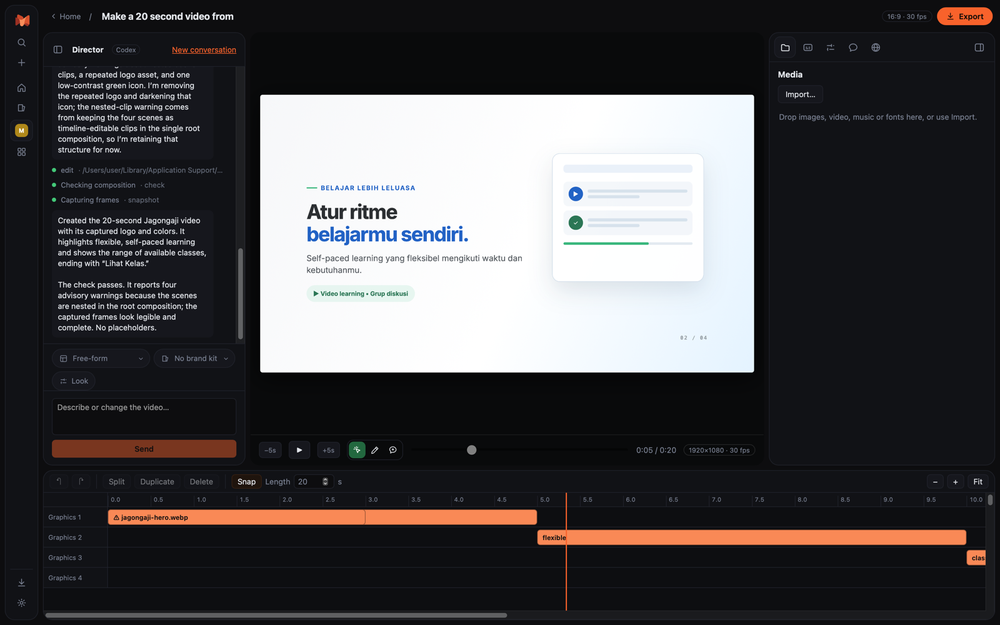
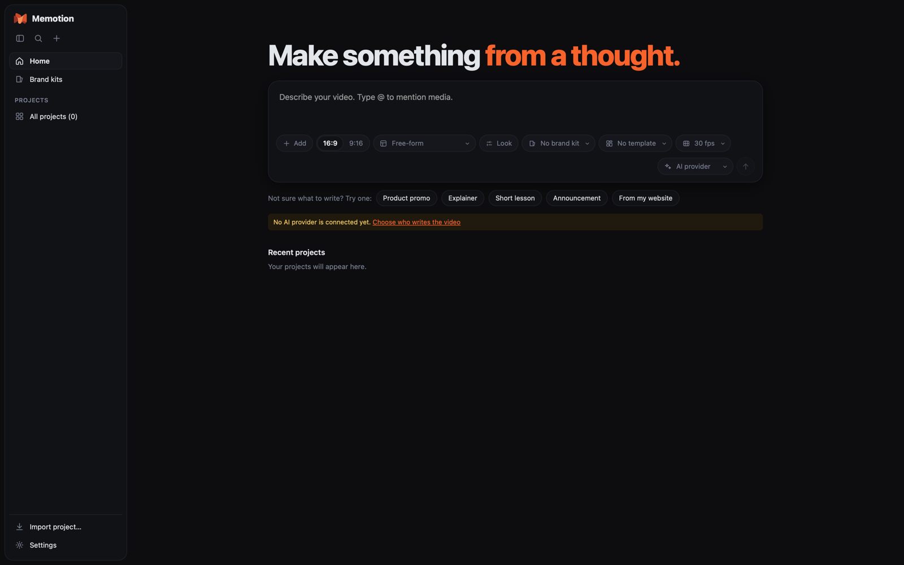
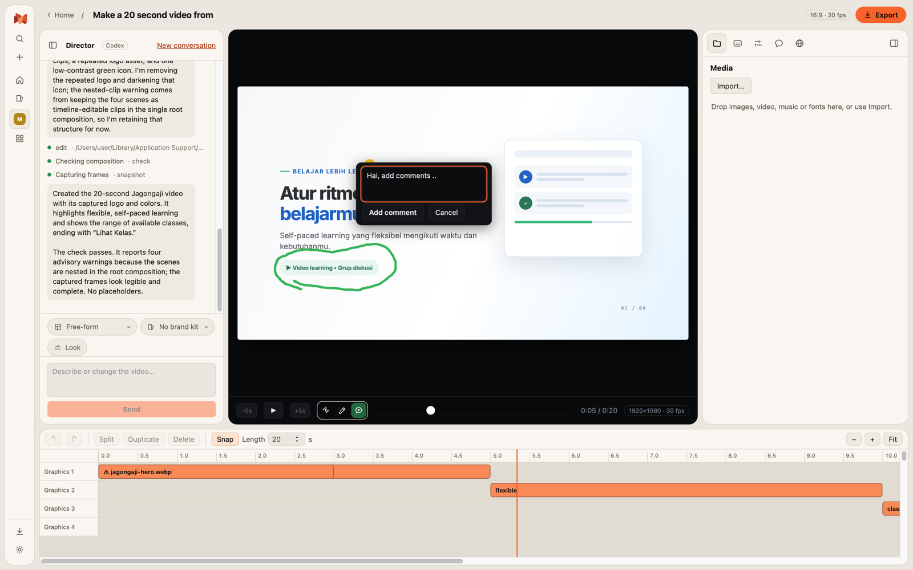
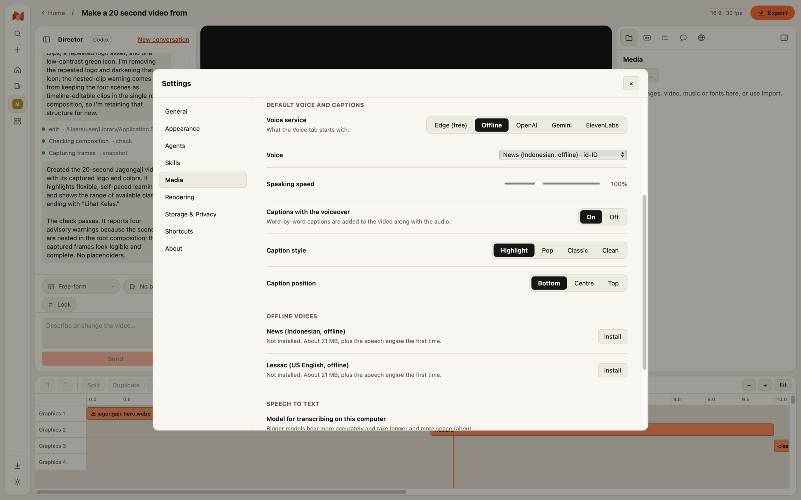
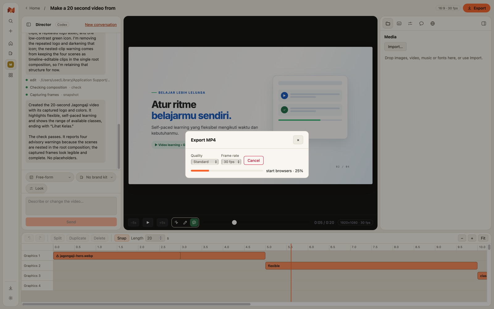

<div align="center">



# Memotion

**Bahasa Indonesia** · [English](README.en.md)

**Ubah deskripsi teks menjadi video gerak (*motion graphics*) HTML/GSAP dengan sutradara AI, lengkap dengan sulih suara, takarir, dan linimasa visual.**

[](LICENSE)
[](#unduh--instalasi)
[](https://github.com/abiiayyas/memotion/actions/workflows/ci.yml)
[](https://github.com/abiiayyas/memotion/actions/workflows/build.yml)

[Unduh / Download](#unduh--instalasi) · [Fitur](#fitur-utama) · [Arsitektur](docs/engineering/ARCHITECTURE.md) · [Pengembangan](#menjalankan-dari-kode-sumber) · [Changelog](CHANGELOG.md)

</div>

---

<div align="center">
  
</div>

## Tentang Memotion

**Memotion** adalah aplikasi desktop gratis dan sumber terbuka (*open source*) untuk membuat video gerak dari perintah teks. Anda menjelaskan video yang diinginkan, sutradara AI menulis komposisi HTML/GSAP di balik layar, lalu Anda meninjaunya secara langsung dan mengekspornya ke **MP4 (16:9 atau 9:16, 30 atau 60 fps)** menggunakan mesin render sumber terbuka [HyperFrames](https://github.com/heygen-com/hyperframes) (`0.8.168`).

Seluruh proyek dan berkas disimpan secara lokal di komputer Anda. Kunci API disimpan aman di *keychain* sistem operasi (`@napi-rs/keyring`) dan tidak pernah ditulis dalam teks polos ke disk. Telemetri serta pemeriksaan pembaruan otomatis HyperFrames selalu dinonaktifkan.

---

## Tampilan & Alur Kerja

<table>
  <tr>
    <td width="50%" valign="top">
      
      <br />
      <strong>Beranda</strong> — Tulis ide video, lampirkan media dengan <code>@</code>, pilih rasio 16:9 atau 9:16, struktur cerita, gaya visual <em>Look</em>, <em>Brand kit</em>, <em>Template</em>, frame rate, serta penyedia AI atau agen CLI lokal.
    </td>
    <td width="50%" valign="top">
      
      <br />
      <strong>Pilih, Gambar &amp; Komentar di Pratinjau</strong> — Klik elemen langsung di kanvas video, lingkari area yang ingin diubah, atau sematkan komentar berwaktu agar sutradara AI merevisi elemen yang tepat.
    </td>
  </tr>
  <tr>
    <td width="50%" valign="top">
      
      <br />
      <strong>Suara, Takarir &amp; Agen AI</strong> — Buat sulih suara lewat Edge TTS, suara offline Piper Bahasa Indonesia &amp; Inggris, OpenAI, Google Gemini TTS, atau ElevenLabs; transkripsi audio dengan <code>whisper.cpp</code>; serta hubungkan agen CLI lokal.
    </td>
    <td width="50%" valign="top">
      
      <br />
      <strong>Linimasa &amp; Ekspor MP4</strong> — Geser, potong, belah, dan kelompokkan klip dengan <em>undo/redo</em> di linimasa multi-lajur, lalu ekspor ke MP4 16:9 atau 9:16 pada 30 atau 60 fps.
    </td>
  </tr>
</table>

---

## Fitur Utama

- **Sutradara AI & Agen Coding Lokal:** Hubungkan endpoint kompatibel OpenAI (preset OpenAI, Anthropic, Gemini, DeepSeek, xAI Grok, OpenRouter, OpenCode Zen, Command Code, Custom) atau jalankan **Claude Code**, **Codex**, dan **OpenCode** secara terisolasi lewat server MCP lokal per sesi.
- **Alat Pratinjau Interaktif & Reviewer Visual:** Pilih elemen langsung dari DOM pratinjau (*Select*), coret area tertentu (*Draw*), atau tinggalkan pin komentar berwaktu (*Comment*). Penyedia dengan kemampuan visi dapat meninjau tangkapan layar adegan secara otomatis lewat alat `review`.
- **Linimasa Visual Multi-Lajur:** Geser, pangkas tepi, belah (`S`), duplikasi (`D`), hapus (`⌫`), seleksi multi-klip dengan kotak marquee, pindah lajur, *snap*, dan *undo/redo* atomik melalui `hyperframes timeline`.
- **Sulih Suara & Takarir Per Kata:** Dukungan **Edge TTS**, suara *offline* **Piper** (`sherpa-onnx` Bahasa Indonesia & Inggris), **OpenAI TTS**, **Google Gemini TTS**, dan **ElevenLabs**, serta transkripsi audio/video lewat Whisper API atau `whisper.cpp` lokal dengan 4 gaya takarir (`highlight`, `pop`, `classic`, `clean`).
- **Brand Kit, Look, Template, Skill & Tangkap Situs:** Simpan palet warna, font, dan logo di *Brand kit*; pilih gaya visual & struktur cerita dari katalog *Look*; gunakan *Template* bervariabel; pasang *Skill* Markdown dari GitHub atau folder lokal; serta tangkap aset situs web untuk referensi desain.
- **Impor Proyek & Render Offline:** Impor proyek HyperFrames maupun Remotion (dianalisis dan dikonversi AI, atau dirender langsung menjadi klip video), dilengkapi salinan GSAP lokal agar pratinjau dan render tetap berjalan tanpa internet.

---

## Unduh & Instalasi

Unduh installer terbaru untuk **macOS** (`.dmg`) dan **Windows** (`.exe`) melalui halaman **[GitHub Releases](https://github.com/abiiayyas/memotion/releases/latest)**.

> [!NOTE]
> **Membuka aplikasi pertama kali (tanpa sertifikat berbayar):**
> - **macOS (Gatekeeper):** Klik kanan aplikasi *Memotion* di folder Applications lalu pilih **Open** → **Open** (atau izinkan lewat *System Settings > Privacy & Security > Open Anyway*).
> - **Windows (SmartScreen):** Pada jendela *Windows protected your PC*, klik **More info** lalu pilih **Run anyway**.

**Kebutuhan runtime untuk render video:** pastikan `ffmpeg` dan `ffprobe` terpasang di sistem Anda (misalnya `brew install ffmpeg` di macOS atau `winget install Gyan.FFmpeg` di Windows), lalu unduh peramban Chrome render dari menu **Settings > Rendering**.

---

## Menjalankan dari Kode Sumber

Membutuhkan **Node.js 22+**, **pnpm**, **Rust** (untuk shell Tauri), dan **ffmpeg** di `PATH` (macOS atau Windows).

```bash
pnpm install
pnpm dev            # jalankan aplikasi Tauri dengan hot reload
pnpm typecheck      # pemeriksaan TypeScript strict (app dan sidecar)
pnpm test           # uji unit dan integrasi Vitest
pnpm build          # build aplikasi rilis untuk platform saat ini
pnpm build:mac      # build bundle .app dan installer .dmg macOS
pnpm build:win      # build installer NSIS (.exe) Windows
```

Untuk memisahkan data pengembangan dari proyek asli Anda:

```bash
MEMOTION_DATA_DIR=/tmp/memotion-dev pnpm dev
```

Panduan kontribusi dan detail arsitektur tersedia di [CONTRIBUTING.md](CONTRIBUTING.md) dan [docs/engineering/ARCHITECTURE.md](docs/engineering/ARCHITECTURE.md).

---

## Struktur & Teknologi

```text
app/
  src/              antarmuka React + TypeScript (Beranda, Editor, Linimasa, Pratinjau, Pengaturan)
  src-tauri/        shell desktop Tauri 2 (Rust): meluncurkan sidecar Node dan mengelola jendela
  scripts/          skrip persiapan biner Node untuk rilis
sidecar/
  src/              server Hono lokal: loop agen AI, runner CLI MCP, TTS/STT, media, proxy pratinjau
  test/             uji unit dan integrasi Vitest
assets/             logo utama dan ikon aplikasi
docs/               dokumentasi arsitektur dan tangkapan layar
```

| Bagian | Teknologi |
|---|---|
| Shell Desktop | Tauri 2 (Rust) |
| Antarmuka | React 19, TypeScript, Vite |
| Sidecar & Keamanan | Node.js 22, Hono, `@napi-rs/keyring`, Zod |
| Mesin Video | HyperFrames (`0.8.168`), GSAP, FFmpeg |
| Suara & Transkripsi | Edge TTS, `sherpa-onnx` (Piper offline), OpenAI, Gemini TTS, ElevenLabs, `whisper.cpp` |

---

## Lisensi & Atribusi

- **Kode sumber Memotion:** Lisensi [MIT](LICENSE).
- **Mesin render video:** [HyperFrames](https://github.com/heygen-com/hyperframes) (Apache-2.0).

| Komponen Pihak Ketiga | Lisensi |
|---|---|
| [HyperFrames](https://github.com/heygen-com/hyperframes) | Apache-2.0 |
| [sherpa-onnx](https://github.com/k2-fsa/sherpa-onnx) & model suara Piper | Apache-2.0 (dan lisensi per model suara) |
| [whisper.cpp](https://github.com/ggml-org/whisper.cpp) | MIT |
| [GSAP](https://gsap.com/standard-license) (diunduh saat dipakai) | GreenSock Standard License |
| FFmpeg (biner sistem) | LGPL / GPL sesuai build terpasang |

Rincian lengkap dependensi dan pemberitahuan pihak ketiga tersedia di [THIRD_PARTY_NOTICES.md](THIRD_PARTY_NOTICES.md). Pelaporan kerentanan keamanan dapat mengikuti panduan di [SECURITY.md](SECURITY.md).
